```{python}
#| include: false
from sod.article import numbers

N = numbers()
```

::: {.callout-note appearance="simple" icon=false}
## In short

- **From December 2022 to September 2026, new Stack Overflow questions averaged `{python} N["att_abs"]` below what comparable Stack Exchange sites predict.** The gap grew every year, from `{python} N["att_2023"]` in 2023 to `{python} N["att_2026"]` in 2026. That adds up to about **`{python} N["missing"]` fewer questions** than expected.
- **Every one of the largest tags fell** against its own trend (`{python} N["n_tags"]` of the top 300; three retired tags excluded). But one prediction was backwards: **older, well-documented tags fell *less*, not more**. Tags created after ChatGPT's training cut-off held up better.
- **The questions still asked are longer, newcomers come back less often, and fewer questions get a quick answer.** These "what and who" predictions were pre-registered; after the planned correction for multiple tests, none of them is confirmed.
:::

::: {.column-page-inset-right}
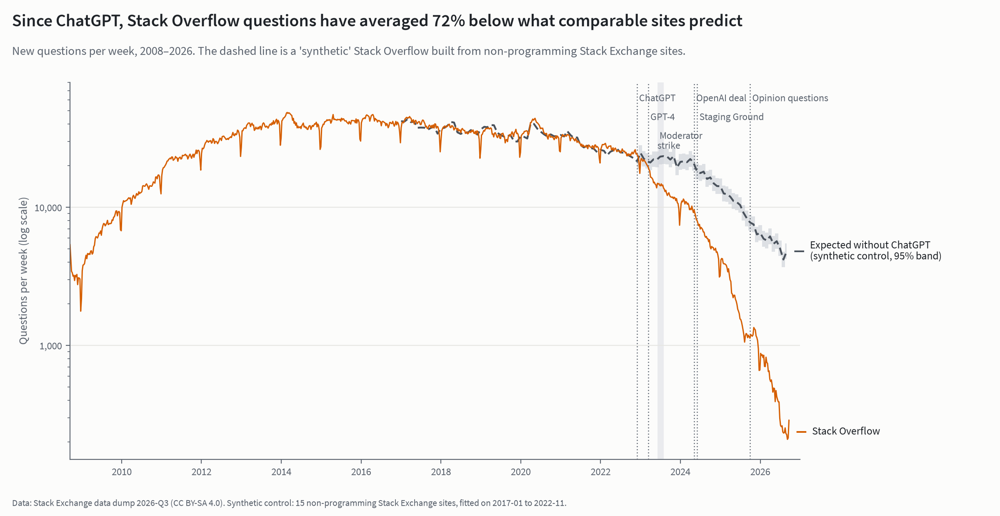{.light-content fig-alt="Line chart of weekly new Stack Overflow questions from 2008 to 2026 on a log scale. Questions rise to about 40,000 a week by 2014, drift down slowly to about 25,000 by late 2022, then fall steeply to a few hundred a week by 2026. A dashed synthetic-control line built from non-programming sites continues the slow decline, ending near 5,000 a week."}
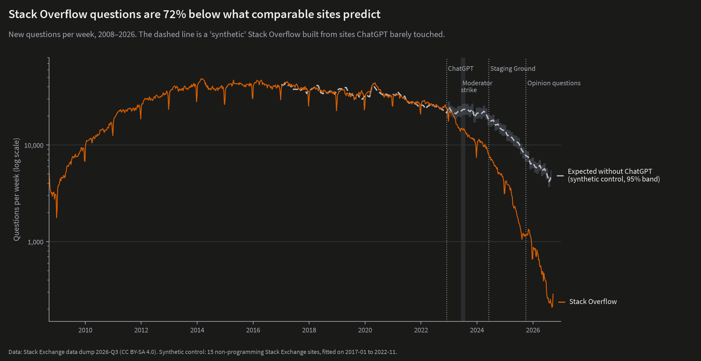{.dark-content fig-alt="Line chart of weekly new Stack Overflow questions from 2008 to 2026 on a log scale, actual vs a synthetic-control counterfactual; actual falls far below the counterfactual after ChatGPT."}
:::

## The question

Stack Overflow questions have been falling since about 2014, so a decline after ChatGPT (released 30 November 2022) is not news by itself. The questions this analysis answers are:

1. **How much of the fall is beyond the trend that was already under way?**
2. **Is it specific to programming**, or did all of Stack Exchange fall?
3. **Which technologies fell most**, what kind of questions remain, and **who left**: new askers, or the experts who answered?

The closest earlier study, by del Rio-Chanona, Laurentsyeva and Wachs [-@delriochanona2024], found a 25% relative drop in Stack Overflow activity within six months of ChatGPT. This analysis extends the window to almost four years and adds tag-level, question-level and user-level detail.

Everything here comes from the public Stack Exchange data dump (2026-Q3 release, cut-off 30 September 2026): 27 sites, including Stack Overflow, its four versions in other languages, six other tech sites and fifteen non-programming sites. **Before fitting any model on post-ChatGPT data, I wrote down the hypotheses, methods and decision rules and locked them** ([pre-registration](https://github.com/johnpospisil/stackoverflow-decline/blob/main/PREREGISTRATION.md)). Every later change is logged there with the date and whether it was made before or after seeing results.

## How big is the gap?

To say how far Stack Overflow fell *because of* something, you need an estimate of where it would have been otherwise. The main estimate uses a **synthetic control** [@abadie2010]: a weighted blend of the fifteen non-programming sites (Physics, Mathematics, Science Fiction, Biology, Bicycles and others), with weights chosen so the blend tracks Stack Overflow's monthly questions as closely as possible from 2017 to November 2022. After that, the blend shows what "Stack Overflow, if it had behaved like those sites" would look like. Before ChatGPT, the blend tracked Stack Overflow within about 6% a month on average.

| Period | Stack Overflow vs synthetic control |
|---|---|
| 2023 | `{python} N["att_2023"]` |
| 2024 | `{python} N["att_2024"]` |
| 2025 | `{python} N["att_2025"]` |
| 2026 (to September) | `{python} N["att_2026"]` |
| **December 2022 – September 2026, average** | **`{python} N["att"]`** (95% interval `{python} N["att_ci"]`) |

: The gap grows every year. Each row is the average monthly gap in that period. {tbl-colwidths="[55,45]"}

**The headline number is an average of monthly gaps.** Each month counts equally, so the deep gaps of 2025–26 weigh as much as the shallower ones of 2023. Counted in questions instead, Stack Overflow received `{python} N["actual_post"]` questions over the whole period against `{python} N["cf_post"]` expected, `{python} N["cum_gap"]` in total.

::: {.column-page-inset-right}
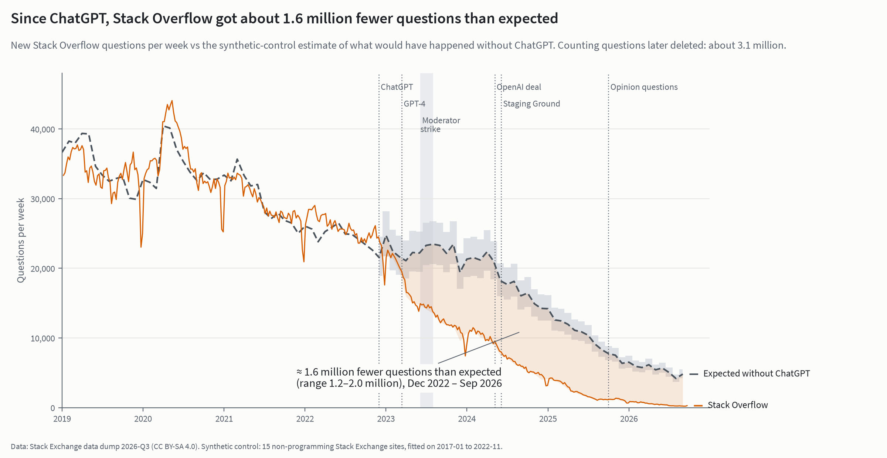{.light-content fig-alt="Weekly Stack Overflow questions 2019 to 2026 on a linear scale, with the gap between actual and expected questions shaded: about 1.6 million fewer questions than expected from December 2022 to September 2026."}
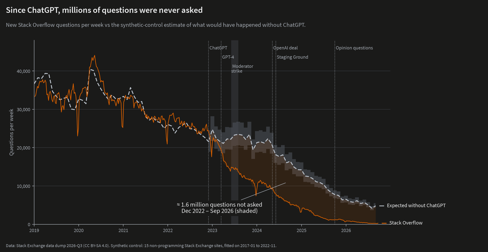{.dark-content fig-alt="Weekly Stack Overflow questions 2019 to 2026, gap between actual and expected shaded."}
:::

That is about **`{python} N["missing"]` fewer questions than expected** (range `{python} N["missing_range"]`). This counts only questions still in the dump. Stack Overflow deletes many questions, and the dump leaves them out. Counting every question asked, including those later deleted, the shortfall is about `{python} N["missing_deleted"]` (`{python} N["missing_deleted_range"]`).

**Is it real?** Stack Overflow's gap is the largest of all 16 sites when each site in turn is treated as if it were Stack Overflow: it ranks `{python} N["rank"]`. That is the strongest result this test can give with 16 sites. Fake break dates in 2019, 2020 and 2021, using only pre-ChatGPT data, give gaps of `{python} N["time_placebos"]`. Those are *positive* and far smaller than the real one.

**Three other methods agree.** Each predicts Stack Overflow's own path from its pre-ChatGPT history alone, without the comparison sites:

- **interrupted time series** (a trend-plus-seasonality regression with a break at ChatGPT): `{python} N["its"]`, or `{python} N["its_covid"]` with the trend fitted only on the faster post-COVID decline
- **exponential smoothing (ETS) forecast:** `{python} N["ets"]`
- **Prophet forecast:** `{python} N["prophet"]`

Across `{python} N["n_variants"]` pre-registered robustness checks, the synthetic-control estimate ranges from `{python} N["rob_range"]`. The checks cover other break dates, dropping the 2023 moderator strike, a longer pre-period, weekly data, other donor sets, deleted questions included, and ending in September 2025 before Stack Overflow's own 2025 policy changes.

::: {.column-page-inset-right}
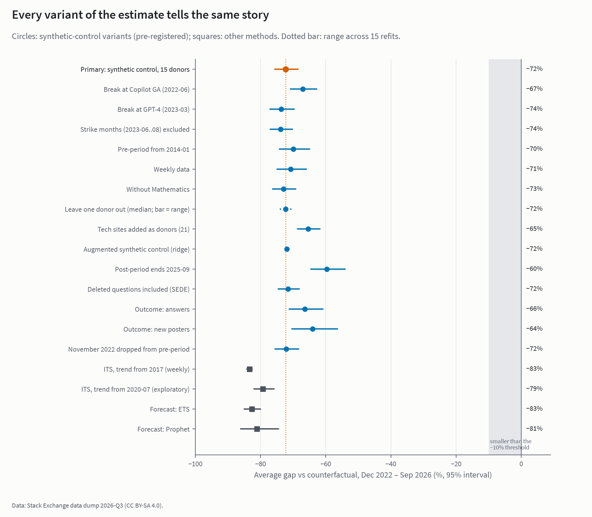{.light-content fig-alt="Forest plot of 15 robustness variants and four supporting estimates, all between about minus 60 and minus 83 percent."}
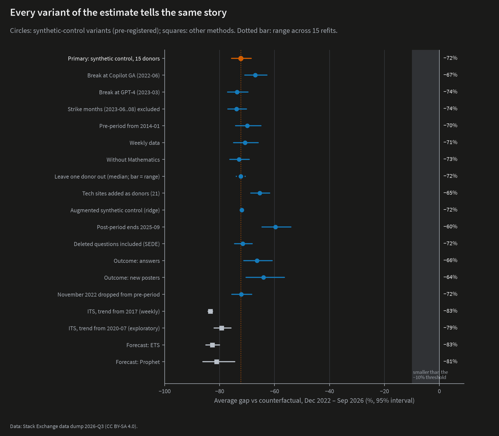{.dark-content fig-alt="Forest plot of robustness variants, all strongly negative."}
:::

## Is it just programming?

**No site escaped, but programming Q&A fell furthest.** The comparison sites also dropped: against their own pre-2022 trends, the median non-programming site fell `{python} N["donor_gap"]`, against Stack Overflow's `{python} N["so_own_gap"]` measured the same way. The pre-registered test calls a decline "platform-wide" if the comparison sites fall at least 0.8 times as much as Stack Overflow on the log scale. Here the ratio is `{python} N["donor_ratio"]`.

That cuts both ways. The fall is mostly specific to programming. But the synthetic control measures Stack Overflow's fall *beyond* sites that also fell. If AI tools also pulled people away from Physics or Cooking, the `{python} N["att_abs"]` understates Stack Overflow's total loss.

::: {.column-page-inset-right}
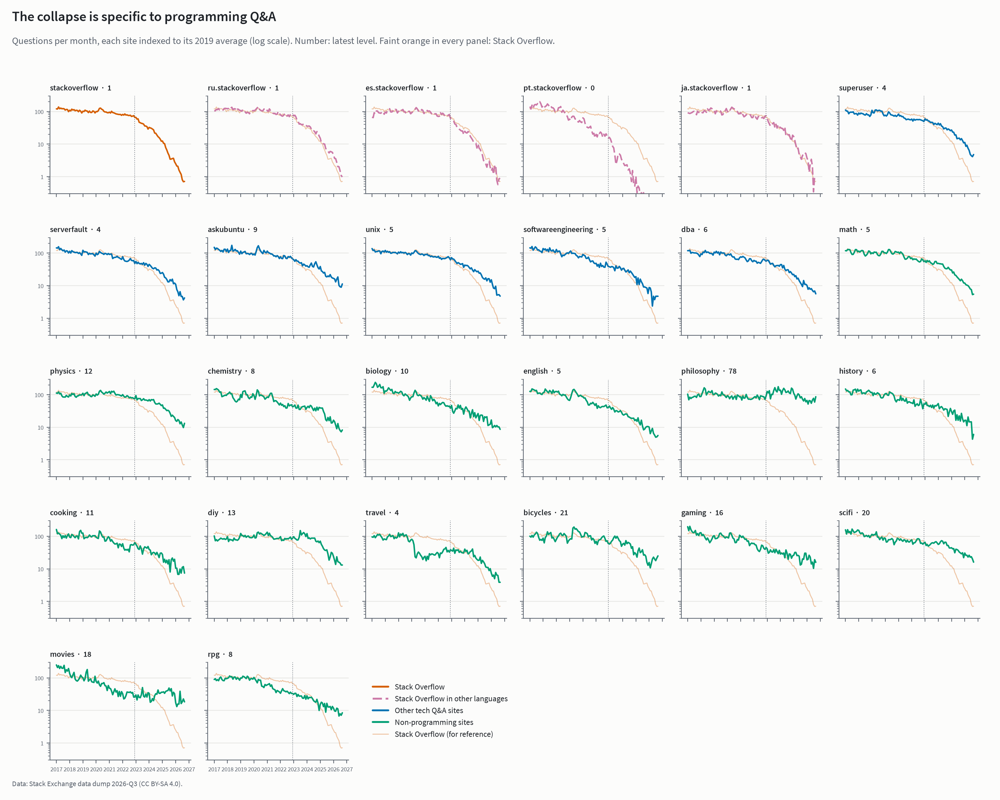{.light-content fig-alt="Small multiples of 26 Stack Exchange sites, questions indexed to 2019 = 100. Stack Overflow and its foreign-language versions end near 1, other tech sites between 4 and 10, and most non-programming sites between 5 and 21; Philosophy ends at 78."}
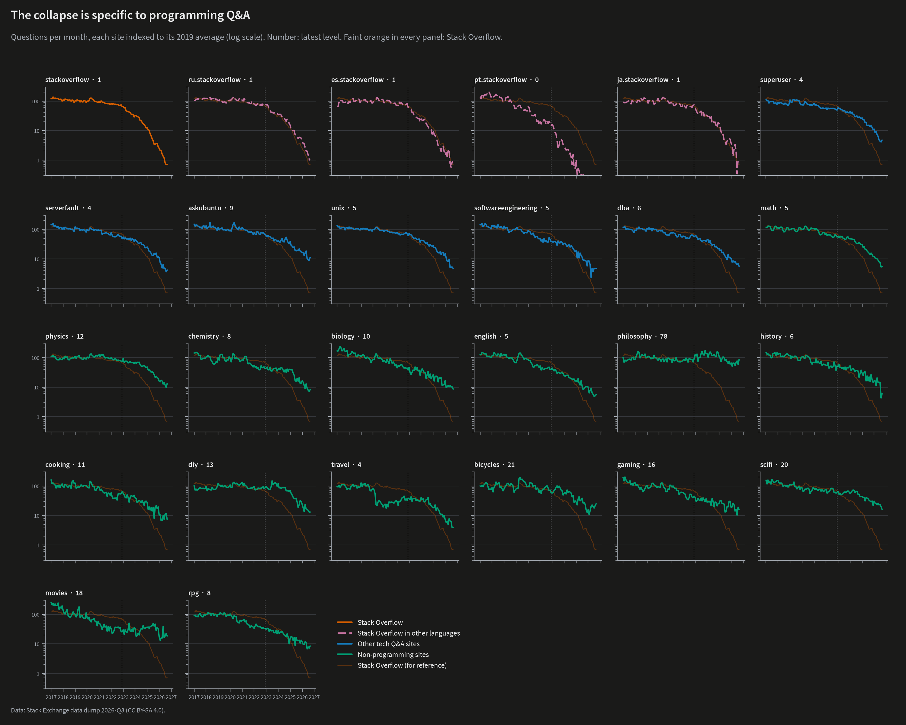{.dark-content fig-alt="Small multiples of 26 Stack Exchange sites indexed to 2019, every site falls, programming sites furthest."}
:::

Stack Overflow's Russian-language site is a useful extra check, because ChatGPT was not officially available in Russia. A difference-in-differences comparison, which tracks how far the two sites' paths diverged, puts English Stack Overflow `{python} N["did_ru"]` lower relative to the Russian site (95% interval `{python} N["did_ru_ci"]`). Russian users could still reach ChatGPT through VPNs, so this contrast is smaller than the true effect.

## Which technologies fell most?

Each of the top 300 Stack Overflow tags of 2019–21 was compared with its own pre-2022 trend in a hierarchical model, which pulls small, noisy tags toward the average. `{python} N["n_tags"]` tags remain after excluding three that Stack Overflow retired or merged. **Every one fell, and every interval is below zero.** Data tags (pandas, dataframe) were among those that fell most, and mobile and enterprise tags (iOS, Android, Kotlin, Spring Boot) among those that fell least.

Take the exact ranking with care. The model extends each tag's 2017–22 trend four years forward, so a tag that was growing fast before ChatGPT (Flutter, Next.js, PyTorch) gets a steeply rising "expected" line, and its fall looks bigger. In plain counts, with no trend assumed, most large tags fell between `{python} N["tag_raw_p90"]` and `{python} N["tag_raw_p10"]` from 2021 to 2025. The two rankings agree only moderately (rank correlation `{python} N["tag_rank_rho"]`). On plain counts, the basic, well-documented topics (list, arrays, jQuery, MySQL) fell most. The [tag lookup](https://github.com/johnpospisil/stackoverflow-decline/tree/main/app) shows both numbers for every tag.

::: {.column-page-inset-right}
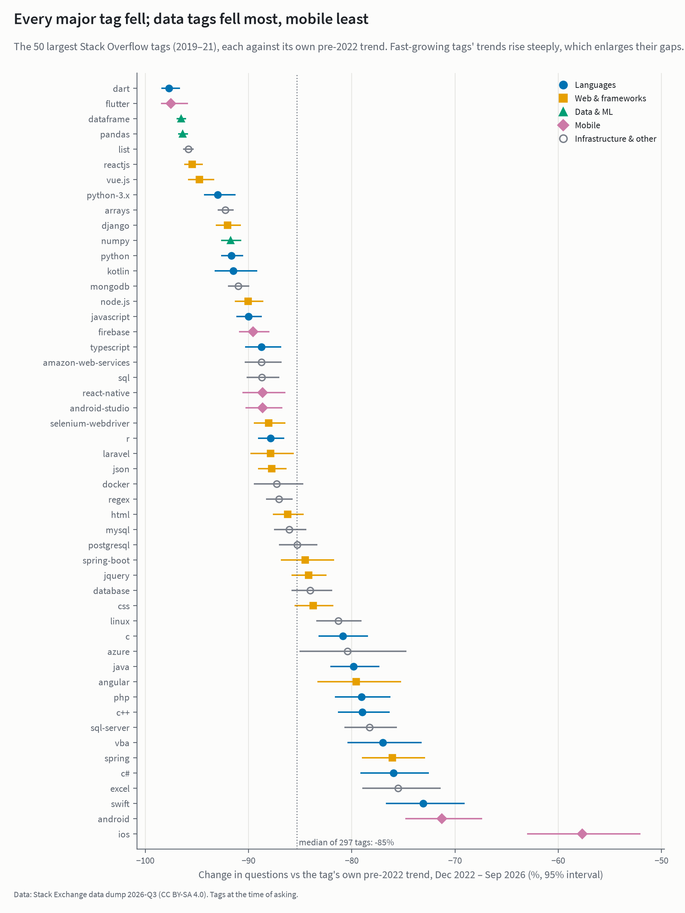{.light-content fig-alt="Dot plot of the 50 largest tags, percent change against each tag's own trend with intervals; all between about minus 58 percent (iOS) and minus 98 percent (Dart)."}
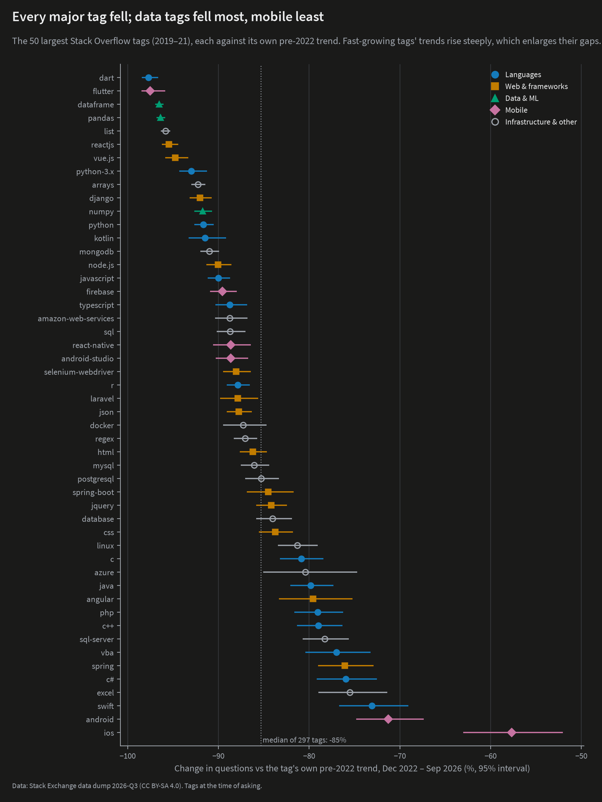{.dark-content fig-alt="Dot plot of the 50 largest tags' declines, all strongly negative."}
:::

### The "thin training data" test

A popular explanation is that chatbots answer well where they saw lots of training data. That predicts that **old, well-documented technologies fall most**, and that **technologies newer than the chatbots' training data fall least**. The pre-registration tested both halves (H2):

- **Older tags fell *less*, not more.** The age effect is `{python} N["age_slope"]` per standard deviation of log age (95% interval `{python} N["age_slope_ci"]`), the opposite of the prediction. Part of this comes from older tags already declining faster before 2022.
- **Tags created after ChatGPT's training cut-off did hold up better.** The `{python} N["new_tags_n"]` tags first used after September 2021 (with at least 200 questions) were `{python} N["new_tags_gap"]` below a lifecycle benchmark (`{python} N["new_tags_ci"]`), against `{python} N["top300_gap"]` for the median top-300 tag. The benchmark is how earlier tags grew at the same age. Genuinely new technologies (`{python} N["new_kind"]`) and new versions of old ones (`{python} N["vf_kind"]`) fared about the same.

The rule needed both halves, so **H2 is not supported**. Both halves are worth knowing: the "thin training data" story fits new tags, but not the comparison between old and middle-aged ones. The two measures also use different yardsticks: a lifecycle benchmark for new tags, the tag's own trend for old ones. The same lifecycle method applied before ChatGPT gives `{python} N["calib"]`, so it is not biased much.

::: {.column-page-inset-right}
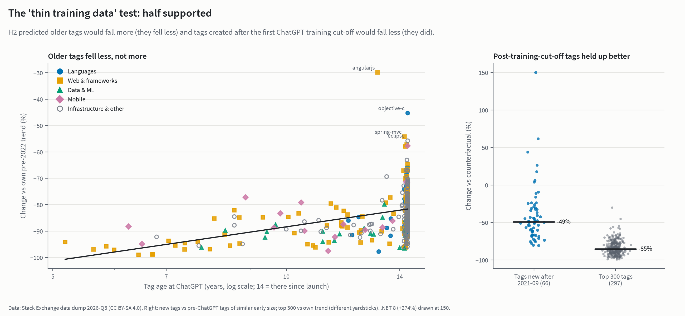{.light-content fig-alt="Left: scatter of tag decline against tag age with an upward fitted line, older tags falling less. Right: post-2021 tags' declines against a lifecycle benchmark, median about minus 49 percent, compared with minus 85 percent for top-300 tags."}
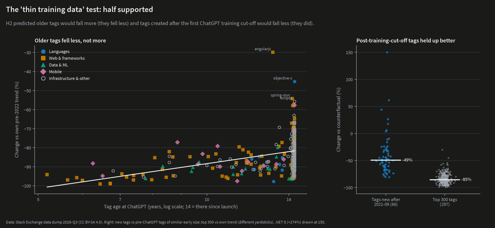{.dark-content fig-alt="Tag decline vs age, and post-2021 tags vs their lifecycle benchmark."}
:::

## What kind of questions remain?

If chatbots take the easy questions, the questions left should be "harder" (H3). Comparing 2021 with 2025, with each year's questions reweighted to the same mix of tags:

- **Longer:** median body `{python} N["body_2021"]` → `{python} N["body_2025"]` characters; `{python} N["body_within"]` within tags. This holds even under the worst case for deleted questions (Lee bounds, `{python} N["body_lee"]`) [@lee2009].
- **Slightly more code:** `{python} N["code_within"]` percentage points within tags, but not robust to deleted questions.
- **Duplicate closures did not fall:** `{python} N["dup_2021"]` → `{python} N["dup_2025"]`.
- **The share from first-time askers did not fall:** `{python} N["ft_2021"]` → `{python} N["ft_2025"]`.

Two of four measures moved as predicted, and the rule needed three, so **H3 is not supported**. The askers did change, though: the median asker's account was `{python} N["acct_age_2021"]` days old in 2021 and `{python} N["acct_age_2025"]` in 2025.

::: {.column-page-inset-right}
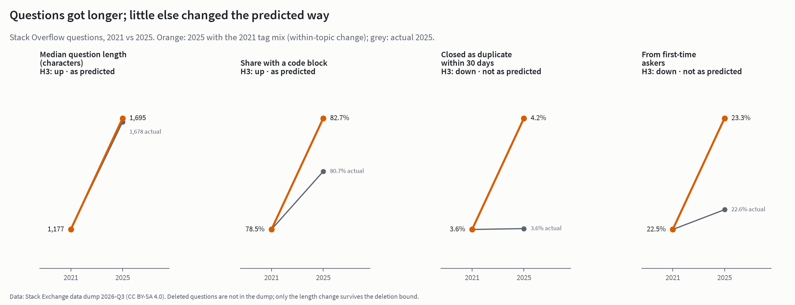{.light-content fig-alt="Slope chart of question measures, 2021 vs 2025: body length up sharply; code share, duplicate closures and first-time share roughly flat."}
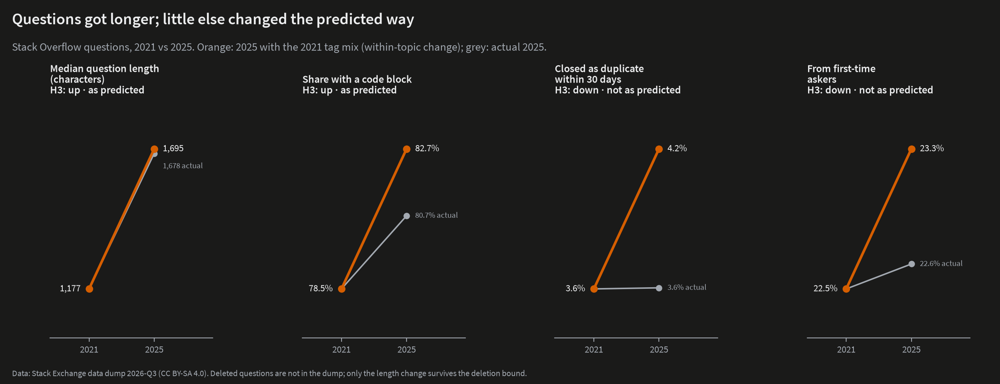{.dark-content fig-alt="Slope chart of question measures, 2021 vs 2025."}
:::

## Who left?

### Newcomers

First-time askers fell about as much as all questions (`{python} N["ft_askers_att"]` against the synthetic control). Their *share* of questions rose `{python} N["ft_share_att"]`, the opposite of the prediction (H4, part a). **But fewer newcomers came back.** Among people whose first post was a question, the chance of posting again within 12 months fell from `{python} N["ret12_before"]` (2019–21 arrivals) to `{python} N["ret12_after"]` (2023–26 arrivals). For those arriving after Staging Ground launched in June 2024, it was `{python} N["ret12_sg"]`. Staging Ground is the review step that new askers' questions now go through.

::: {.column-page-inset-right}
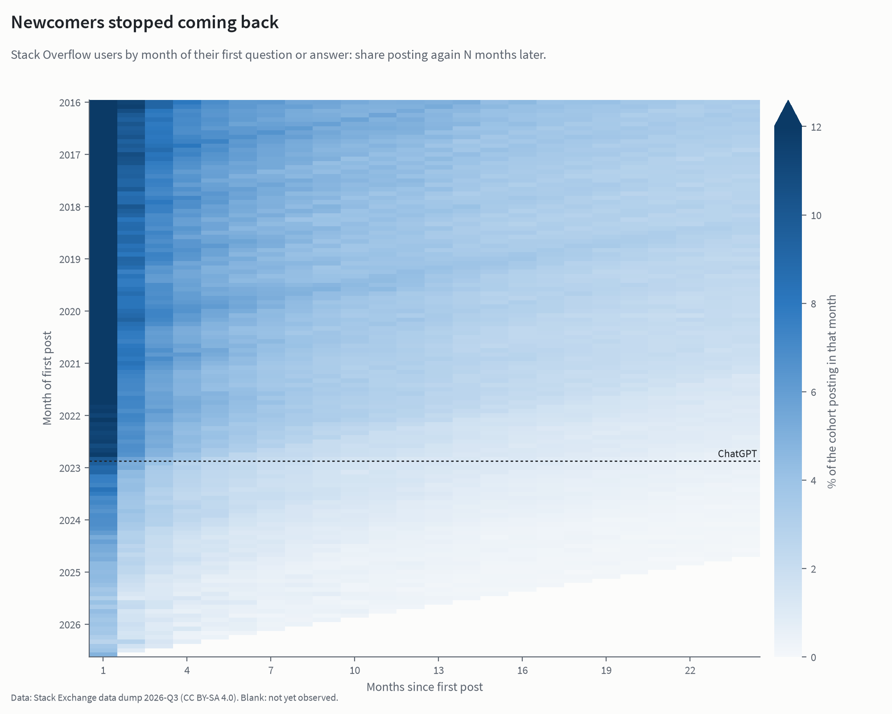{.light-content fig-alt="Heatmap of the share of each monthly cohort of new users posting again N months later; the colour fades for cohorts arriving after late 2022."}
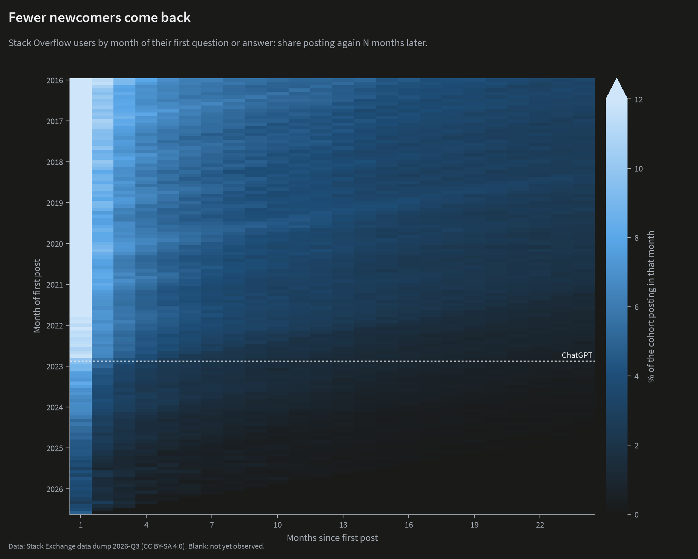{.dark-content fig-alt="Retention heatmap; later cohorts return less."}
:::

### The experts who answer

The "core" answerers are the top 1% of answerers in 2019–21. Two years later, `{python} N["core_d2"]` of them were still answering, and three years later `{python} N["core_d3"]`. The same group defined in each earlier window kept `{python} N["ref_d2"]` and `{python} N["ref_d3"]`. On the comparison sites, core answerers kept answering at about their usual rate (ratio `{python} N["core_ratio_donor"]` vs Stack Overflow's `{python} N["core_ratio_so"]`). **So Stack Overflow's experts left faster than earlier generations did.** The evidence is not conclusive, for two reasons:

- earlier generations were already dropping out about 2 points faster each time (extrapolated: `{python} N["h5_trend_exp_d2"]` and `{python} N["h5_trend_exp_d3"]`)
- only four earlier groups exist to compare against

After the pre-registered correction for testing four hypotheses at once [@holm1979], the result does not reach significance (p = `{python} N["h5_p"]`, adjusted `{python} N["h5_holm_p"]`). **H5 is consistent with the data but not confirmed.**

## Is the community still responsive?

Less than it was. The share of questions answered within 24 hours fell from `{python} N["a24_before"]` (2019–21) to `{python} N["a24_2025"]` (2025). Among questions answered within a week, the median wait rose from `{python} N["speed_2019"]` to `{python} N["speed_2025"]` hours. More answers now go to old questions: `{python} N["old_q_2025"]` of 2025 answers were to questions over a year old, against `{python} N["old_q_2019"]` in 2019. This part is exploratory, not pre-registered.

::: {.column-page-inset-right}
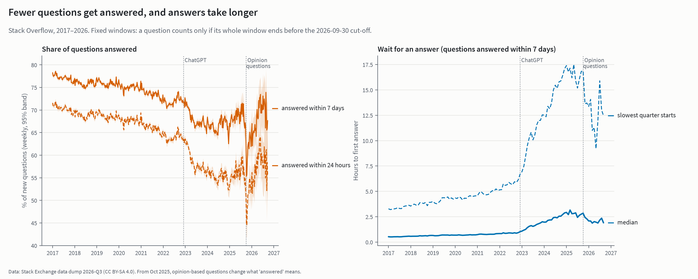{.light-content fig-alt="Share of Stack Overflow questions answered within 24 hours and median hours to first answer, 2017 to 2026; the share steps down in 2023 and the wait rises."}
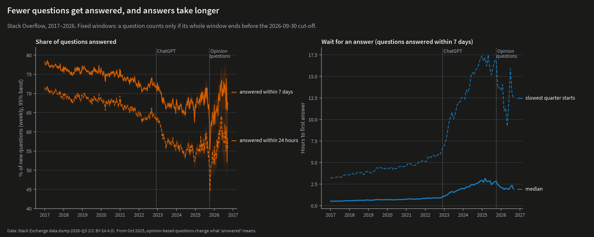{.dark-content fig-alt="Stack Overflow responsiveness 2017 to 2026."}
:::

## Where did people go?

There is **no sign the questions moved to GitHub issues.** Take the main GitHub repository for each of `{python} N["gh_pairs"]` technologies (pandas, React, Flutter and so on). Their issue activity drifted down to a median index of `{python} N["gh_index"]` (2019–21 = 100) by early 2025. Stack Overflow questions in the matching tags fell to `{python} N["so_tag_index"]`, while GitHub as a whole grew to `{python} N["gh_all_index"]`.

The likelier destination is chatbots and coding assistants. In Stack Overflow's own Developer Survey, the share of respondents using AI tools rose from `{python} N["ai_use_2023"]` (2023) to `{python} N["ai_use_2024"]` (2024) and `{python} N["ai_use_2025"]` (2025). Survey respondents are themselves Stack Overflow visitors, so these shares describe that group, not all developers. This analysis can't observe chatbot use directly, so this part is context, not proof.

## What this doesn't show

- **It doesn't prove ChatGPT alone caused the fall.** Several things coincide:
  - GitHub Copilot and other coding assistants
  - Stack Overflow's own changes: Staging Ground (2024), opinion-based questions (October 2025) and AI features
  - the 2023 moderator strike

  Breaking at the Copilot release (June 2022) or GPT-4 (March 2023) instead gives similar estimates, so "AI coding tools generally" fits better than "ChatGPT specifically".
- **It measures Stack Overflow relative to other sites that also fell.** The total effect of AI on Stack Overflow is probably larger.
- **It doesn't count deleted questions** in most measures. Including them changes the headline from `{python} N["att"]` to `{python} N["att_deleted"]`. The share of questions later deleted rose after 2022, which affects the question-mix measures most.
- **It doesn't say the remaining questions are "better" or "worse"**, only how they changed on four measures.
- **It ends at the dump cut-off** (30 September 2026). It is a snapshot, not a live tracker.

## Scorecard against the pre-registration

| | Hypothesis | Result |
|---|---|---|
| **H1** (primary) | Questions fell below what the trend and comparison sites predict | **Supported** under the monthly-interval reading: `{python} N["att"]`, ranked `{python} N["rank"]`. See the note on the interval below. |
| H2 | Older/larger tags fall more; post-2021 tags fall less | **Not supported.** Older tags fell *less*; post-2021 tags did fall less |
| H3 | Remaining questions are "harder" (3 of 4 measures) | **Not supported** (2 of 4) |
| H4 | Newcomer arrivals fall more than questions, and newcomers return less | **Not supported.** Arrivals fell in step; returns did fall (`{python} N["ret12_before"]` → `{python} N["ret12_after"]`) |
| H5 | The core answerer group shrank faster than before | **Not confirmed** after correcting for four tests (adjusted p = `{python} N["h5_holm_p"]`) |

: Pre-registered hypotheses and results. H2–H5 are corrected together with Holm's method, as pre-registered. {tbl-colwidths="[8,42,50]"}

**A note on H1's interval.** The pre-registration asked for a "95% conformal confidence interval" for the average gap [@chernozhukov2021]. Two readings were possible:

- **Monthly reading:** average the per-month 95% intervals. This gives `{python} N["att_ci"]`, with `{python} N["months_excl_zero"]` of `{python} N["months_post"]` monthly intervals excluding zero.
- **Constant-effect reading:** test a single effect assumed equal in every month. This gives `{python} N["att_const_ci"]`, which does not even contain the point estimate, because the gap grew from about 0 to −92% and was nowhere near constant.

I chose the monthly reading *after* seeing both, and logged it as a deviation. Under the constant-effect reading, H1 would fail its interval criterion. Every other check (rank, time placebos, robustness checks, three other methods) points the same way.

## Methods appendix

**Data.** Stack Exchange data dump, 2026-Q3 (cut-off 2026-09-30), 27 sites, parsed from XML to Parquet. File hashes match the community checksum list, and no watermarked rows were found. Questions are counted by creation date (UTC), with tags as they were when the question was asked. The dump omits deleted posts; deleted-question counts come from the Stack Exchange Data Explorer (SEDE), the site's public query tool, and are used in a robustness check.

**Synthetic control.** Monthly log questions, each site demeaned by its pre-period mean. Pre-period 2017-01 to 2022-11, excluding March–June 2020 (COVID); post-period 2022-12 to 2026-09. Weights are non-negative and sum to one, fitted on pre-period months only. The fit's pre-period error (root mean squared) is `{python} N["pre_rmspe"]` log points.

**Interrupted time series.** Weekly log questions with a linear trend, yearly seasonality (Fourier terms), holiday weeks and a COVID indicator. Standard errors are Newey–West (8 lags), which allow for autocorrelation. The level change (`{python} N["its_level"]`) and slope change (`{python} N["its_slope"]` per year) at the break can't be read separately: a positive level change is offset by a steep slope. The article therefore reports gaps. Refitting on pre-period weeks only gives the same gap. A one-year holdout before ChatGPT had errors of `{python} N["its_holdout"]`.

**Forecasts.** ETS and Prophet were trained to November 2022. In a backtest (trained to 2019-11, predicting three years), their errors by horizon year were:

- ETS: `{python} N["ets_bt"]`
- Prophet: `{python} N["prophet_bt"]`

Prophet failed that backtest. It is reported because it was pre-registered, not because it is reliable.

**Tag model.** A hierarchical negative binomial model of monthly question counts for each tag. Each tag has its own pre-trend, seasonality and a post-period line; predictors are age, size, documentation maturity (share closed as duplicates, 2019–21) and family. Tags that Stack Overflow retired or merged are excluded by a fixed rule.

**Multiple comparisons.** H2–H5 are corrected together with Holm's method at α = 0.05 [@holm1979]. Each family's decision p-value is defined in the pre-registration's deviations log.

**Deviations.** Every change to the pre-registered plan, with its date and whether it came before or after seeing results, is in the [deviations log](https://github.com/johnpospisil/stackoverflow-decline/blob/main/PREREGISTRATION.md#9-deviations). The full validation review is in [validation.md](https://github.com/johnpospisil/stackoverflow-decline/blob/main/report/validation.md).

**Reproducing.** `make all` rebuilds everything from the raw dump, in about 2.5 hours on a laptop. `make all SAMPLE=1` runs the whole pipeline on a small synthetic dump in about 4 minutes. Every number in this article is read from the pipeline's output files, not typed by hand.

**Data licence and attribution.** Stack Overflow and Stack Exchange content is licensed CC BY-SA 4.0 by its contributors. This analysis publishes derived counts only, no post text or user names. It is independent and not affiliated with or endorsed by Stack Overflow or Stack Exchange.

## References

::: {#refs}
:::
